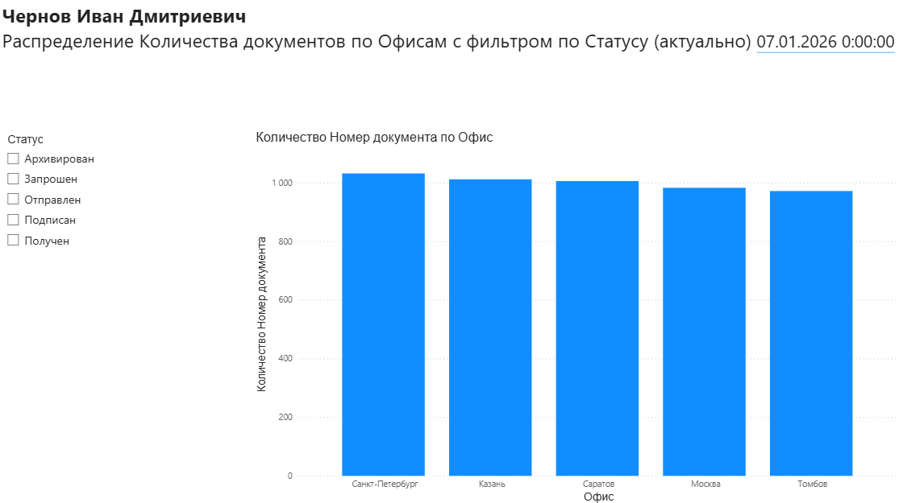
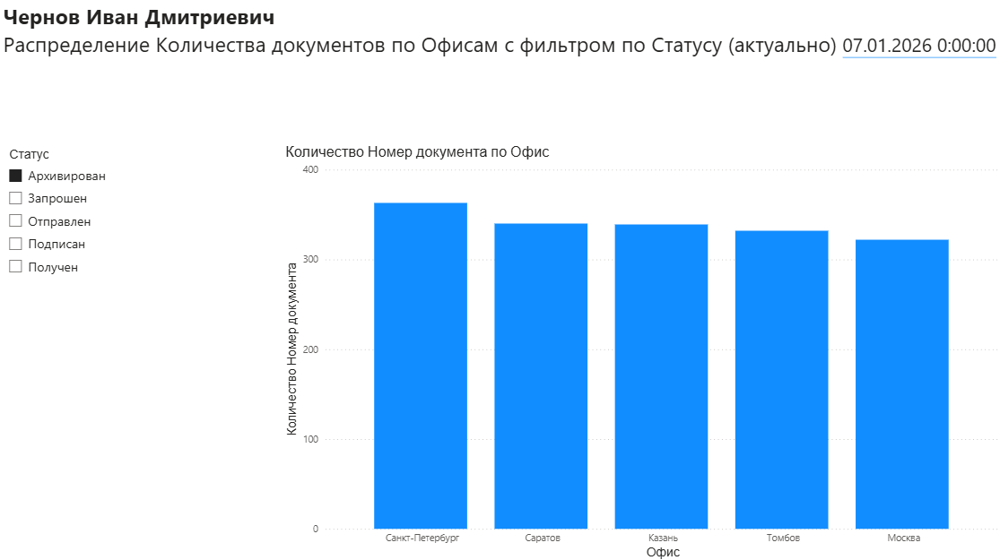
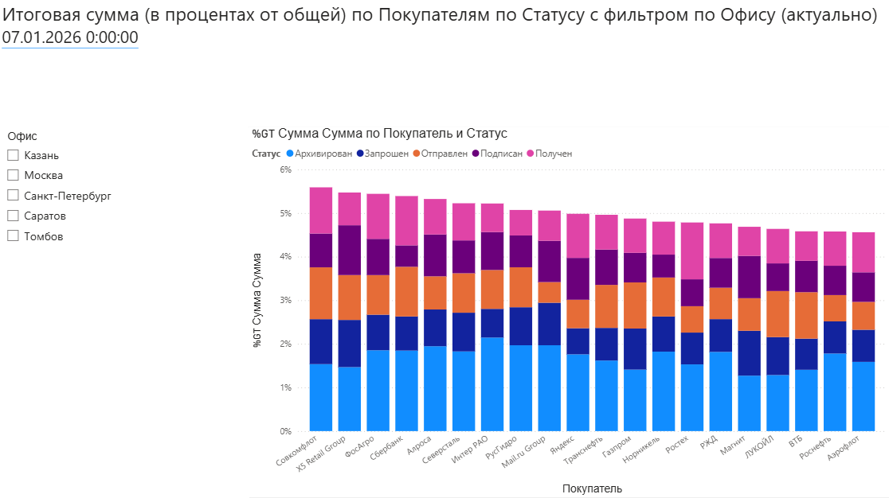
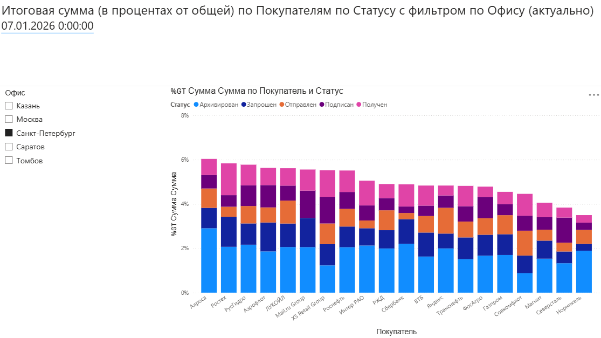

# powerbi-document-flow-dashboard
# Дашборд для контроля документооборота (Power BI)

## Бизнес-задача

Компании с несколькими филиалами необходимо отслеживать распределение документов и их статусы. Руководству нужно понимать, как распределяется нагрузка между офисами, на каком этапе документы «застревают» и какие контрагенты создают основную нагрузку.

## Что было сделано

* Выгрузил и почистил данные в Power Query.
* Написал меры на DAX (включая расчет процентов для 100% Stacked Bar Chart).
* Настроил интерактивные срезы (фильтры) по офисам и статусам, чтобы графики перестраивались в один клик.

## Что показывают графики

### Страница 1: Количество документов по офисам

Столбчатая диаграмма показывает объем документов в разрезе 5 городов. С помощью фильтра по статусу можно увидеть, как меняется картина.

*Пример: если отфильтровать только архивные документы, видно, что лидерство остается за Санкт-Петербургом.*

### Страница 2: Структура сумм по контрагентам

Здесь используется 100% Stacked Bar Chart. Он показывает долю каждого статуса (от «Запрошен» до «Получен») в общей сумме по конкретному покупателю. Внизу по оси X видны крупные B2B-контрагенты (X5 Retail Group, Сбербанк, Аэрофлот, РЖД и др.).

*Пример: при выборе конкретного офиса (например, Санкт-Петербурга) видно, что у одних контрагентов (например, РЖД или Роснефти) большая часть суммы документов уже в статусе «Получен», а у других — застряла в статусе «Запрошен».*

## Файлы

Файл `dashboards.pbix` лежит в этом же репозитории. Его можно скачать и открыть в Power BI Desktop.
